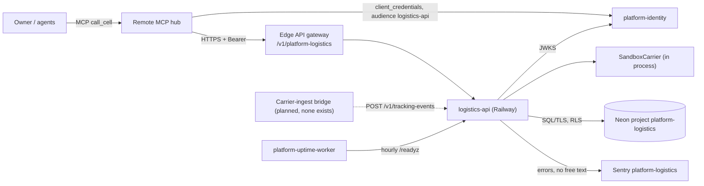
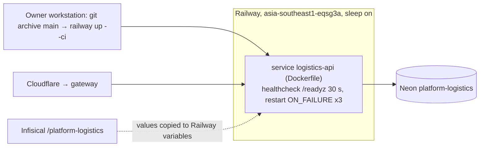

# Book Logistics Platform — System Architecture

เอกสารนี้สรุปสถาปัตยกรรมของ `logistics-api` จากโค้ดและ config ที่ `origin/main` `bde9db7` (runtime ที่ live ตาม ops record คือ `501601f`) รายละเอียดเชิงลึกอยู่ใน Core 22 diagram pack [`docs/diagrams/`](../docs/diagrams/README.md) สิ่งที่ยืนยันจาก repo ไม่ได้ติด **[ต้องยืนยัน]** หรืออยู่ในคำถามค้าง

## 1. Architecture style และเหตุผล

**Style:** modular monolith ขนาดเล็กหนึ่ง process (FastAPI) ต่อ bounded context `logistics` (rates, shipments, labels, tracking) บน shared library `platform-backend-core` ที่ pin ด้วย commit, carrier เป็น **ports-and-adapters** (`Carrier` protocol ใน `carriers.py`, ตอนนี้มีแค่ `SandboxCarrier` ใน process), ข้อมูลแยกต่อ workspace ด้วย PostgreSQL forced RLS, deploy เป็น serverless container

เหตุผลที่เห็นจากหลักฐาน:

- เป็น platform boundary ใหม่ ไม่มี implementation เดิม (`PRODUCT.md` §Positioning: "current implementation ... is nothing") ผู้บริโภคพึ่งได้เฉพาะ API/contract
- carrier จริงยังไม่มี; migration gates คือ "carrier sandbox, label replay, tracking deduplication" — จึงแยก carrier หลัง protocol และทำ sandbox ที่ deterministic ไม่มี network/credential
- การซื้อ label มีผลข้างเคียงภายนอก (เงิน) จึงต้อง lease ก่อนเรียก carrier และ quarantine ผลที่ไม่แน่นอน ([ADR-0005](../docs/diagrams/08-adr/ADR-0005-label-lease-uncertain-quarantine.md))
- core เดียวกับอีก 7 service เพื่อ auth/HTTP/DB behaviour เหมือนกัน ([ADR-0001](../docs/diagrams/08-adr/ADR-0001-fastapi-on-platform-backend-core.md))

## 2. Quality-attribute scenarios

| ID | Attribute | Stimulus → Response | Measure | หลักฐาน |
|---|---|---|---|---|
| QA-01 | Security (isolation) | token ของ workspace A อ่าน shipment ของ B | ไม่เห็นแถว (RLS), 404 | forced RLS ใน `migrations.py`; `runtime_tests/test_shipments.py`, `test_http.py` |
| QA-02 | Security (authz) | ไม่มี token / scope ไม่พอ | 401 / 403 | `app.py` `require_scope` 9 routes, core `http.py` |
| QA-03 | Reliability (no double purchase) | carrier timeout หลังส่งคำขอซื้อ label แล้ว client retry | ไม่ซื้อซ้ำ; label อยู่สถานะ uncertain จน reconcile | `store.py`, `runtime_tests/test_labels.py`, [ADR-0005](../docs/diagrams/08-adr/ADR-0005-label-lease-uncertain-quarantine.md) |
| QA-04 | Correctness (tracking) | carrier ส่ง tracking event ซ้ำ | เก็บครั้งเดียว (dedup), state เปลี่ยนตาม `TRANSITIONS` เท่านั้น | `rules.py`, `runtime_tests/test_tracking.py`, `test_rates_and_transitions.py` |
| QA-05 | Availability (cold start) | request แรกหลัง sleep + Neon suspend | ตอบได้ภายใน pool wait 20 s; warm `/readyz` ~1.3 s (วัด 2026-11-04) | core `db.py`@21d5f44, `runtime_tests/test_pool_reuse.py` |
| QA-06 | Privacy | exception มีที่อยู่ผู้รับใน message | Sentry ไม่มี free text | [ADR-0006](../docs/diagrams/08-adr/ADR-0006-sentry-errors-only-no-free-text.md), `runtime_tests/test_sentry.py` |
| QA-07 | Robustness | input ผิด/ใหญ่ | 422 generic (`InvalidInput`), body ≤ 16 KiB | `errors.py`, `app.py` `max_body_bytes=16384`, `runtime_tests/test_error_mapping.py` |
| QA-08 | Modifiability | เพิ่ม carrier จริง | implement `Carrier` protocol + ตั้ง `LOGISTICS_CARRIERS`; store ไม่เปลี่ยน | `carriers.py` `configured_carriers` |

## 3. Context diagram

ภาพ C4 เต็ม: [05-c4-context.md](../docs/diagrams/05-c4-context.md)

## 4. Components / containers

| Container | เทคโนโลยี | หน้าที่ | หลักฐาน |
|---|---|---|---|
| `logistics-api` (serve) | Python 3.12, FastAPI, uvicorn, `platform-backend-core@21d5f44` | 9 `/v1` routes + probes, PORT 8080, non-root | `Dockerfile`, `__main__.py`, `app.py` |
| migrate one-off | image เดียวกัน, `python -m platform_logistics migrate` | DDL ด้วย DDL role | `__main__.py`, `migrations.py` |
| Neon PostgreSQL | Postgres (CI 16) | `shipment`, `shipment_label`, `tracking_event`, `platform_schema_migrations`, forced RLS | `migrations.py` |

Components ([07-c4-component.md](../docs/diagrams/07-c4-component.md)):

| Component | ไฟล์ | หน้าที่ |
|---|---|---|
| `create_app` boundary + probes | core `http.py` | body limit, timeout, redacted 500, `/healthz` `/readyz` `/metrics` |
| `require_scope` / `TokenVerifier` | core `auth.py`, `http.py` | RS256, `iss`/`aud`/`ws`/scopes |
| `CaptureErrors` | `_sentry.py` | ชั้นในสุด ส่ง error ให้ Sentry |
| Routes + pydantic | `app.py` | strict body, generic exception handler |
| `LogisticsStore` | `store.py` | idempotency, label lease, reconcile, tracking dedup, readiness `logistics_schema` + `carriers` |
| `rules` | `rules.py` | ตรวจ parcel/address, billable weight, `TRANSITIONS` |
| `carriers` | `carriers.py` | `Carrier` protocol, `SandboxCarrier`, `configured_carriers` |
| `InvalidInput` | `errors.py` | domain error เดียวที่ map เป็น 422 |

## 5. Tech stack

| ชั้น | เทคโนโลยี | หลักฐาน |
|---|---|---|
| Runtime | Python ≥ 3.12, FastAPI/psycopg/PyJWT ผ่าน core, uvicorn `>=0.34,<1`, `sentry-sdk>=2.72,<3` | `pyproject.toml`, `uv.lock` |
| Shared library | `platform-backend-core==0.1.0` pin rev `21d5f44d…` | `pyproject.toml` |
| Build | Dockerfile `python:3.12-slim`, non-root | `Dockerfile` |
| Quality | uv locked, Ruff, mypy, pytest บน PostgreSQL 16 + coverage gate 95%, security scans | `.github/workflows/check.yml` |

## 6. Data stores

| Store | ข้อมูล | กฎ | หลักฐาน |
|---|---|---|---|
| Neon `platform-logistics` | `shipment`, `shipment_label` (PK `(workspace_id, shipment_id)` = หนึ่ง label ต่อ shipment), `tracking_event` | forced RLS บน `app.workspace_id`; runtime role NOSUPERUSER NOBYPASSRLS; readiness ตรวจ grants + checksums + forced RLS | `migrations.py`, [09-erd.md](../docs/diagrams/09-erd.md), [ADR-0003](../docs/diagrams/08-adr/ADR-0003-own-neon-postgres-forced-rls.md) |
| `SandboxCarrier` memory | label ledger ใน memory | หายเมื่อ restart (sandbox เท่านั้น) | `carriers.py` |

ไม่มี R2, cache หรือ queue

## 7. Integrations

| ระบบ | ทิศทาง | ใช้ทำอะไร | สถานะ | หลักฐาน |
|---|---|---|---|---|
| platform-identity (JWKS) | API → identity | RS256, audience `logistics-api`, scopes `rates:read`, `shipments:read`, `shipments:write`, `labels:write`, `tracking:write` | live | `__main__.py`, `app.py`, [ADR-0004](../docs/diagrams/08-adr/ADR-0004-identity-jwt-workspace-scopes.md) |
| Edge API gateway | gateway → API | route `platform-logistics`, token passed through | live | `platform-api-gateway@51c4711` `routes.json` |
| Remote MCP hub | hub → gateway → API | cell `platform-logistics`, ครบ 5 scopes | live | `platform-mcp-remote-worker@7d127c2` `PLATFORM_CELLS`, `CELLS` |
| Carrier จริง | — | ยังไม่มี; มีแค่ sandbox | not built | `carriers.py`, `PRODUCT.md` |
| Carrier-ingest bridge (`tracking:write`) | bridge → API | ส่ง tracking event | planned, ไม่มีใน code | [05-c4-context.md](../docs/diagrams/05-c4-context.md) |
| Neon / Sentry / uptime worker | ตาม context | DB, errors, hourly `/readyz` | live | `__main__.py`, `_sentry.py`, ops record |
| R2, queues/Kafka | — | not_applicable | — | ไม่มีใน `src/` |

## 8. Deployment topology

- Env (ชื่อเท่านั้น): `DATABASE_URL`, `JWT_ISSUER`, `JWT_AUDIENCE`, `JWT_JWKS_URL`/`JWT_PUBLIC_KEY`, `LOGISTICS_CARRIERS`, `PORT`, `SENTRY_DSN`, `SENTRY_ENVIRONMENT`, `SENTRY_RELEASE` ([16-deployment.md](../docs/diagrams/16-deployment.md))
- Live URL `https://logistics-api-production-d3bb.up.railway.app`, `/readyz` 200 ใน 1.28 s (ตรวจ 2026-11-04); deploy เป็น CLI ไม่ผูก CI

## 9. ADR สำคัญ

| ADR | การตัดสินใจ |
|---|---|
| [ADR-0001](../docs/diagrams/08-adr/ADR-0001-fastapi-on-platform-backend-core.md) | FastAPI บน `platform-backend-core` ที่ pin |
| [ADR-0002](../docs/diagrams/08-adr/ADR-0002-railway-serverless-dockerfile-cli-deploy.md) | Railway serverless, Dockerfile, deploy ด้วย CLI |
| [ADR-0003](../docs/diagrams/08-adr/ADR-0003-own-neon-postgres-forced-rls.md) | Neon project ของตัวเอง + forced RLS |
| [ADR-0004](../docs/diagrams/08-adr/ADR-0004-identity-jwt-workspace-scopes.md) | identity JWT พร้อม workspace + scopes |
| [ADR-0005](../docs/diagrams/08-adr/ADR-0005-label-lease-uncertain-quarantine.md) | lease ก่อนเรียก carrier, quarantine ผลไม่แน่นอน, reconcile ชัดเจน |
| [ADR-0006](../docs/diagrams/08-adr/ADR-0006-sentry-errors-only-no-free-text.md) | Sentry errors only ไม่มี free text |

## 10. Fitness functions (ที่มีอยู่แล้ว)

| Fitness function | ปกป้องอะไร | รันที่ |
|---|---|---|
| `scripts/check.sh`, `tests/test_contract_check.py`, `tests/test_drift_checks.py`, `scripts/check_schema_pin.py` | contract ตรง schema ที่ pin | CI `contract` (Py 3.11, 3.12) |
| `tests/test_build_hygiene.py` | core pin ตรงกันทุกไฟล์, build hygiene | CI `python` |
| `runtime_tests/test_labels.py`, `test_tracking.py`, `test_rates_and_transitions.py`, `test_shipments.py` | label replay, dedup, transitions, RLS | CI `python` บน PostgreSQL 16 |
| `runtime_tests/test_pool_reuse.py`, `test_error_mapping.py`, `test_review_fixes.py` | pool behaviour, error contract, regressions จาก review | CI `python` |
| `runtime_tests/test_sentry.py` | ไม่มี free text ออกจาก process | CI `python` |
| Coverage gate 95% | ไม่ลด coverage | CI `python` |
| `shared-runtime.yml` | image build, non-root | CI |
| `security.yml` (gitleaks, semgrep, osv-scanner, trivy-fs) | secret/dependency risk | CI |
| `/readyz` (`logistics_schema` + `carriers`) | DB ตรงกับ code และมี carrier ตั้งค่า | Railway healthcheck + uptime worker |

## 11. เอกสารลงรายละเอียด (SDLC phase 07)

| Template | สถานะ | ไฟล์ / เหตุผล |
|---|---|---|
| infrastructure-and-network-design | partial | [16-deployment.md](../docs/diagrams/16-deployment.md), [13-threat-model.md](../docs/diagrams/13-threat-model.md) |
| observability-design | partial | [20-observability.md](../docs/diagrams/20-observability.md); ไม่มี SLO/alert rule |
| capacity-performance-and-cost-plan | not_applicable | tier L0, ไม่มี consumer/traffic; free tier |
| failure-mode-analysis | partial | [14-backup-dr.md](../docs/diagrams/14-backup-dr.md), [21-incident-response.md](../docs/diagrams/21-incident-response.md), [11-state-machines.md](../docs/diagrams/11-state-machines.md) (label uncertain) |
| async-integration-contract | not_applicable | ไม่มี queue/webhook/job; tracking ingest เป็น REST synchronous |
| frontend-architecture | not_applicable | ไม่มี UI |
| tech-debt-register | partial | open questions ใน [docs/diagrams/README.md](../docs/diagrams/README.md), [docs/UPGRADE-PLAN.md](../docs/UPGRADE-PLAN.md) |
| system-landscape | external | อยู่ใน landscape ของ portfolio **[ต้องยืนยัน]** |
| vendor-dependency-review (lock-in) | missing | Railway, Neon, Sentry; carrier vendor ยังไม่เลือก |

## 12. คำถามค้าง

- Q-01: carrier จริงตัวแรกและ consumer แรกคือใคร (ต้องมีก่อน gate "carrier sandbox" ผ่านจริง)
- Q-02: ใครถือ `tracking:write` (carrier-ingest bridge) และจะเป็น webhook จาก carrier หรือ poll
- Q-03: จะปิด direct Railway URL ให้รับเฉพาะจาก gateway เมื่อไร
- Q-04: Neon `platform-logistics` อยู่ใน nightly backup + restore drill หรือไม่; RTO/RPO
- Q-05: `/metrics`, `/docs`, `/openapi.json` เปิดสาธารณะ — ตั้งใจหรือไม่
- Q-06: ชื่อ Railway project และ commit ที่ live ปัจจุบัน (ops record: `501601f`); `docs/runtime.md` ยังเขียน "Nothing has been deployed"

## การอนุมัติ

| บทบาท | สถานะ | วันที่ | ลงนาม |
|---|---|---|---|
| Solution Architect (Book Dev) | รอตรวจ | — | [ต้องยืนยัน] |
| Owner | รอตรวจ | — | [ต้องยืนยัน] |

## แหล่งข้อมูล

- repo `bookchaowalit-backend/platform-logistics` `origin/main` `bde9db7` (live runtime ตาม ops record `501601f`)
- `PRODUCT.md`, `README.md`, `contract.json`, `docs/runtime.md`, `docs/CONTRACT-SURFACE.md`, `docs/UPGRADE-PLAN.md`
- `pyproject.toml`, `uv.lock`, `Dockerfile`, `railway.toml`, `.github/workflows/check.yml`, `.github/workflows/shared-runtime.yml`
- `src/platform_logistics/{__main__,app,store,rules,carriers,errors,migrations,_sentry}.py`, `tests/`, `runtime_tests/`
- `docs/diagrams/` (Core 22 pack, commit `bde9db7`) และ `docs/diagrams/08-adr/ADR-0001…0006`
- `bookchaowalit-backend/platform-api-gateway@51c4711` `routes.json`; `bookchaowalit/platform-mcp-remote-worker@7d127c2` `src/worker.ts`, `wrangler.toml`
- ops record: book-platforms-status, api-gateway-edge (2026-11-03); `curl /readyz` 2026-11-04
