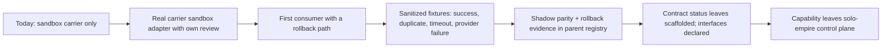

# 01 — Business process (As-Is / To-Be)

## As-Is (จากโค้ดวันนี้)

platform-logistics เป็น platform boundary ของความสามารถ `logistics` ที่มี runtime pilot แบบ workspace-scoped: ขอราคา (rates) → สร้าง shipment แบบ idempotent → ซื้อ label (มี lease และ uncertain quarantine) → รับ tracking event ที่ dedupe ด้วย `carrier_event_id` และขยับสถานะ shipment ตาม `rules.TRANSITIONS`. Carrier ที่มีจริงมีตัวเดียวคือ `SandboxCarrier` (in-process, ไม่มี network, ไม่มี credential). ยังไม่มี consumer ใดเรียกใช้งานจริง (`docs/runtime.md` "no consumer uses it yet").

```mermaid
flowchart LR
  A["Caller: POST /v1/rates"] --> B["Sandbox quote: billable weight + tariff"]
  B --> C["Caller: POST /v1/shipments + Idempotency-Key"]
  C --> D{"Same key seen?"}
  D -- "no" --> E["Insert shipment, status created, rate frozen"]
  D -- "yes, same body" --> F["Replay first shipment 200"]
  D -- "yes, other body" --> G["409 Idempotency conflict"]
  E --> H{"Cancel or buy label?"}
  H -- "cancel" --> I["status cancelled (terminal)"]
  H -- "label" --> J["begin_label: purchasing lease 60 s"]
  J --> K["SandboxCarrier.purchase_label key label/id"]
  K -- "bought" --> L["status labelled + tracking number"]
  K -- "rejected or unavailable" --> M["label failed, shipment back to created"]
  K -- "uncertain" --> N["label_uncertain quarantine"]
  N --> O["POST label/reconcile: find_label"]
  O -- "found" --> L
  O -- "none" --> M
  L --> P["Carrier-ingest bridge: POST /v1/tracking-events"]
  P --> Q{"Duplicate, stale or graph-invalid?"}
  Q -- "duplicate" --> R["200 duplicate, no change"]
  Q -- "stale or invalid move" --> S["stored as recorded"]
  Q -- "valid newer" --> T["applied: shipment status moves"]
  T --> U["in_transit / out_for_delivery / delivered / exception / returned"]
```

Sources: `src/platform_logistics/app.py`, `src/platform_logistics/store.py`, `src/platform_logistics/rules.py`, `src/platform_logistics/carriers.py`, `docs/runtime.md`

## To-Be

ที่มาของ To-Be: `PRODUCT.md`, `docs/UPGRADE-PLAN.md`, `docs/runtime.md` (Staging plan, Deliberate omissions). ไม่มี `specs/` และไม่ได้อ่าน issue.

Sources: `PRODUCT.md` (Positioning, Out of scope), `docs/UPGRADE-PLAN.md` (P0, P1), `docs/runtime.md` (Staging plan step 4), `README.md` (Migration gate)

## Open questions

- ใครคือ consumer แรก (commerce? storefront?) — ไม่มีเอกสารใดระบุ
- carrier จริงตัวไหน (ops record: "A real carrier for logistics" เป็น owner follow-up)
- To-Be ของ label void/refund, retention/purge, multi-parcel, สกุลเงินอื่นนอกจาก THB — `docs/runtime.md` ระบุเป็น deliberate omissions โดยไม่มีแผน
