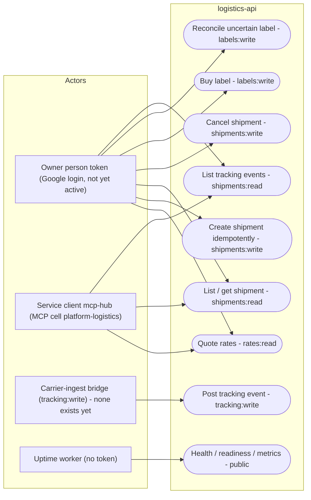

# 02 — Use cases

Actors คือผู้ถือ token ที่ service ตรวจ: JWT RS256 จาก platform-identity (audience `logistics-api`) ที่ต้องมี claim `sub`, `ws` (workspace), `scope` และ scope ที่ route ต้องการ. Workspace มาจาก claim `ws` เท่านั้น ไม่มี body หรือ header ใดเลือก tenant ได้. Endpoint `/healthz`, `/readyz`, `/metrics` มาจาก shared core และไม่ต้องใช้ token.

Sources: `src/platform_logistics/app.py`, `runtime_tests/conftest.py` (claims `iss aud sub ws iat exp jti scope`), `runtime_tests/test_http.py` (`ALL` scope list), `docs/runtime.md` (API table, "trusted carrier-ingest bridge"), `PRODUCT.md` (audience `logistics-api`), ops record: book-platforms-status (2026-11-03)

หมายเหตุ: เส้น owner/hub → use case แสดงสิ่งที่ scope อนุญาตได้ ไม่ใช่ grant ที่ยืนยันแล้ว. ops record ระบุเพียงว่า hub เป็น service client `mcp-hub` ที่มี "31 owner scopes, 8 audiences" และเป็น cell ของทั้ง 8 service — ไม่ได้ระบุว่าได้ scope logistics ตัวใด (เส้น HUB ด้านบนจึงวาดเฉพาะ read).

## Open questions

- hub client `mcp-hub` ได้ scope logistics ตัวใดบ้าง (เขียนได้หรืออ่านอย่างเดียว)?
- owner grant ของ logistics (ส่วนหนึ่งของ "35 permissions") map เป็น scope ใดบ้าง?
- ใครจะถือ `tracking:write` เมื่อมี carrier จริง และจะมี webhook signature check หรือไม่ (`docs/runtime.md`: "this pilot has no carrier webhook signature check")
