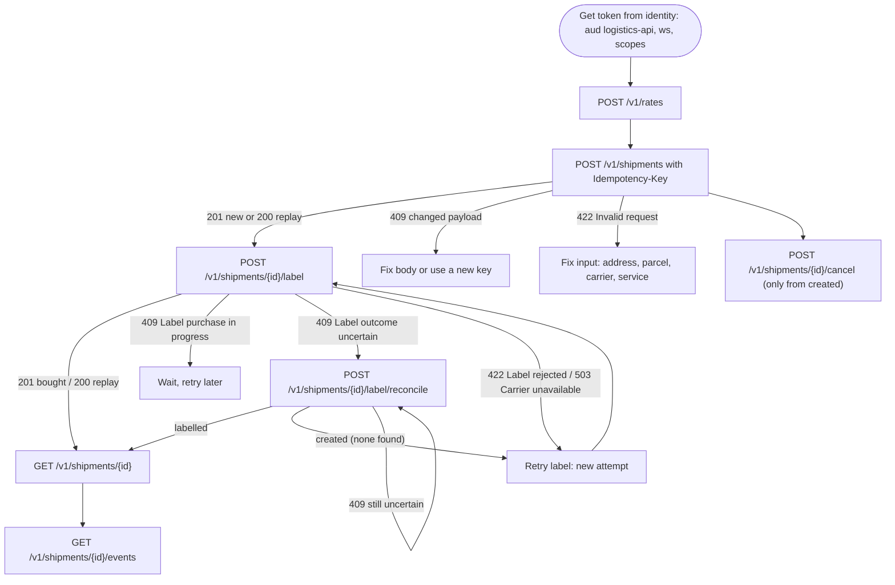
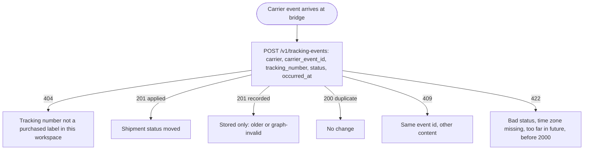
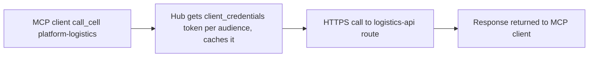
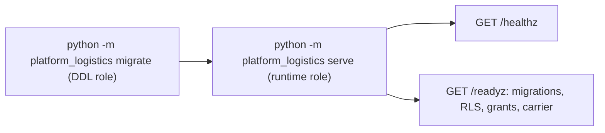

# 03 — User flows (API call flows per caller)

service นี้ไม่มี UI. "user flow" ในที่นี้คือลำดับ API call ของแต่ละ caller ตาม route ใน `app.py`.

## Flow A — Fulfillment caller (owner token หรือ consumer ในอนาคต)

Sources: `src/platform_logistics/app.py`, `src/platform_logistics/store.py` (`purchase_label`, `reconcile_label`, `cancel`), `docs/runtime.md` (API, Label purchase)

## Flow B — Carrier-ingest bridge (`tracking:write`)

Sources: `src/platform_logistics/app.py` (`tracking`), `src/platform_logistics/store.py` (`validate_event`, `record_tracking_event`), `runtime_tests/test_tracking.py`

## Flow C — MCP hub (service client `mcp-hub`)

Sources: ops record: book-platforms-status (2026-11-03) (MCP hub paragraph)

## Flow D — Operator lifecycle

Sources: `src/platform_logistics/__main__.py`, `docs/runtime.md` (Installation and lifecycle)

## Open questions

- Flow B: ยังไม่มี bridge จริง; ใครจะ build และอยู่ที่ไหน?
- Flow C: tool ใดของ hub ที่ map ไป route ใดของ logistics — อยู่ใน `platform-mcp-remote-worker` ซึ่งไม่ได้อ่านในงานนี้
