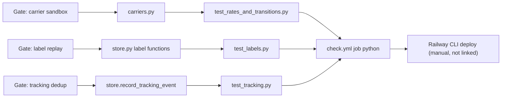

# 04 — Traceability (RTM)

ไม่มี `specs/` และ `contract.json` มี `interfaces: []`. Requirement ด้านล่างจึงดึงจาก `PRODUCT.md` (Success, Measures), migration gates ใน `contract.json`/`docs/runtime.md` และพฤติกรรมที่ `docs/runtime.md` ระบุ. ID (R-xx) ตั้งขึ้นในเอกสารนี้เพื่ออ้างอิงเท่านั้น.

Release/workflow: ทุก test รันใน `check.yml` (job `contract` สำหรับ `tests/`, job `python` สำหรับ `pytest` ทั้งหมดบน PostgreSQL 16). Deploy เป็น Railway CLI ไม่ผูกกับ workflow ใด.

| ID | Requirement | Source | Code module | Test file | Workflow / release |
|---|---|---|---|---|---|
| R-01 | contract ถูกต้องตาม schema ที่ pin | `PRODUCT.md` Success | `scripts/check.py` | `tests/test_contract_check.py` | `check.yml` contract |
| R-02 | vendored schema ตรงกับ sha256 pin | `README.md` | `scripts/check_schema_pin.py` | `tests/test_drift_checks.py` | `check.yml` contract (step "Verify vendored schema") |
| R-03 | contract ตรงกับ registry entry (drift = 0) | `PRODUCT.md` Measures | `scripts/check_registry_alignment.py` | `tests/test_drift_checks.py` | local only (ไม่อยู่ใน CI) |
| R-04 | Gate "carrier sandbox": quote deterministic, sandbox adapter เท่านั้น | `docs/runtime.md` gate table | `carriers.py`, `rules.py` | `runtime_tests/test_rates_and_transitions.py`, `runtime_tests/test_labels.py` | `check.yml` python |
| R-05 | Gate "label replay": หนึ่ง label ต่อ shipment, replay ได้, uncertain quarantine | `docs/runtime.md` | `store.begin_label/finish_label/reconcile_label` | `runtime_tests/test_labels.py`, `runtime_tests/test_http.py`, `runtime_tests/test_review_fixes.py` | `check.yml` python |
| R-06 | Gate "tracking deduplication" | `docs/runtime.md` | `store.record_tracking_event` | `runtime_tests/test_tracking.py`, `runtime_tests/test_http.py` | `check.yml` python |
| R-07 | Shipment idempotent ต่อ `(workspace, Idempotency-Key)` | `docs/runtime.md` Shipments | `store.create_shipment` | `runtime_tests/test_shipments.py` | `check.yml` python |
| R-08 | Workspace isolation ด้วย forced RLS | `README.md` Runtime pilot | `migrations.py`, `store.py` | `runtime_tests/test_shipments.py` (`test_workspaces_are_isolated_and_rls_rejects_foreign_rows`), `runtime_tests/test_pool_reuse.py` | `check.yml` python |
| R-09 | สถานะเปลี่ยนตามกราฟเท่านั้น | `docs/runtime.md` Fulfillment status | `rules.TRANSITIONS` | `runtime_tests/test_rates_and_transitions.py`, `runtime_tests/test_shipments.py` (`test_cancel_only_from_created`) | `check.yml` python |
| R-10 | Error generic; 422 เฉพาะ `InvalidInput` | `docs/runtime.md` API, 422 section | `app.py`, `errors.py` | `runtime_tests/test_error_mapping.py` | `check.yml` python |
| R-11 | `/readyz` 200 เฉพาะเมื่อ migration, RLS, grants และ carrier พร้อม | `PRODUCT.md` Success | `store.ready`, `app.py` readiness checks | `runtime_tests/test_http.py` | `check.yml` python; Railway healthcheck `/readyz` (`.railway/railway.ts`) |
| R-12 | startup error ไม่พิมพ์ค่า config; migrate แยกจาก serve | `docs/runtime.md` | `__main__.py` | `runtime_tests/test_lifecycle.py` | `check.yml` python |
| R-13 | Sentry ไม่มี free text / request data | `PRODUCT.md` Operating Context | `_sentry.py` | `runtime_tests/test_sentry.py` | `check.yml` python |
| R-14 | image build จาก clean checkout, non-root, actions pin SHA | `docs/runtime.md` Container image | `Dockerfile`, workflows | `tests/test_build_hygiene.py` | `shared-runtime.yml` image |
| R-15 | coverage ≥ gate | `PRODUCT.md` Measures | ทั้ง `src/platform_logistics`, `scripts` | ทั้ง suite | `check.yml` python (`coverage-threshold: "95"`) |
| R-16 | ไม่เก็บชื่อ/ที่อยู่/โทรศัพท์/อีเมล | `docs/runtime.md` Data held | `store.RECIPIENT_REF`, `rules.validate_address` | `runtime_tests/test_shipments.py` (`test_invalid_shipments_are_rejected`), `runtime_tests/test_http.py` (`caplog`) | `check.yml` python |
| R-17 | `/readyz` 200 ทุก hourly check | `PRODUCT.md` Measures | — | ไม่มี test ใน repo | uptime worker (นอก repo) |

Sources: `PRODUCT.md`, `README.md`, `contract.json`, `docs/runtime.md`, `.github/workflows/check.yml`, `.github/workflows/shared-runtime.yml`, `.railway/railway.ts`, ไฟล์ test ทั้งหมดใน `tests/` และ `runtime_tests/`

## Open questions

- ไม่มี release/tag ใน repo (`git tag` ว่าง) — release ↔ commit ที่ deploy บันทึกที่ใด?
- R-03 ไม่อยู่ใน CI; ควรย้ายเข้าตาม `docs/UPGRADE-PLAN.md` P1 หรือไม่?
