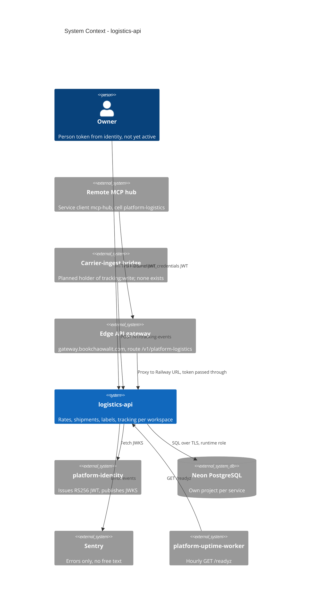

# 05 — C4 Context

Sources: ops record: api-gateway-edge (2026-11-03); `bookchaowalit-backend/platform-api-gateway@51c4711` `routes.json`; `bookchaowalit/platform-mcp-remote-worker@7d127c2` `wrangler.toml` `CELLS` + `src/worker.ts` `PLATFORM_CELLS`, `src/platform_logistics/__main__.py` (`JWT_JWKS_URL`, `DATABASE_URL`), `src/platform_logistics/_sentry.py`, `docs/runtime.md`, `PRODUCT.md` (Operating Context), ops record: book-platforms-status (2026-11-03)

Carrier จริงไม่อยู่ใน context เพราะ `SandboxCarrier` ทำงานใน process (`carriers.py`: "no network, no credentials").

Central architecture: [C4-DIAGRAMS.md](https://github.com/bookchaowalit/architecture-docs/blob/main/docs/architecture/C4-DIAGRAMS.md) ไม่ได้กล่าวถึง logistics (ตรวจด้วย grep)

## Open questions

- (ตอบแล้ว 2026-11-04) gateway มี route `platform-logistics` และ MCP hub เรียกผ่าน gateway; direct `*.up.railway.app` ยังเปิดอยู่ (service ไม่ตรวจ header ของ edge) — จะปิดเมื่อไร?
