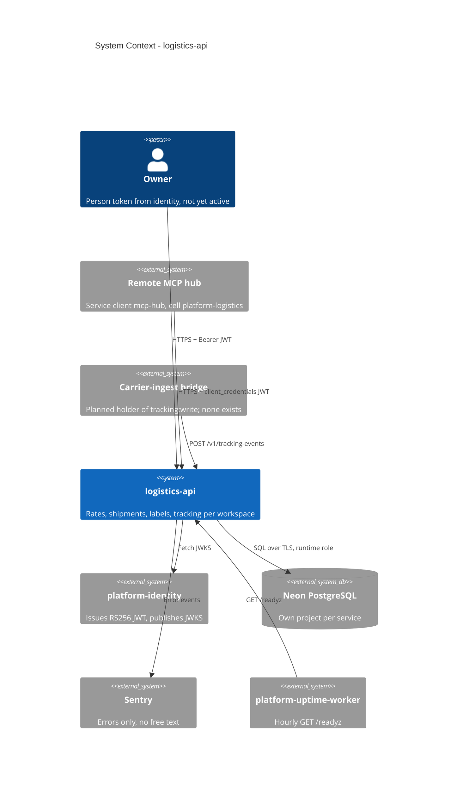

# 05 — C4 Context

Sources: `src/platform_logistics/__main__.py` (`JWT_JWKS_URL`, `DATABASE_URL`), `src/platform_logistics/_sentry.py`, `docs/runtime.md`, `PRODUCT.md` (Operating Context), ops record: book-platforms-status (2026-11-03)

Carrier จริงไม่อยู่ใน context เพราะ `SandboxCarrier` ทำงานใน process (`carriers.py`: "no network, no credentials").

Central architecture: [C4-DIAGRAMS.md](https://github.com/bookchaowalit/architecture-docs/blob/main/docs/architecture/C4-DIAGRAMS.md) ไม่ได้กล่าวถึง logistics (ตรวจด้วย grep)

## Open questions

- ผ่าน edge gateway หรือไม่ — ops record (book-platforms-status) ไม่ระบุ gateway route ของ logistics
