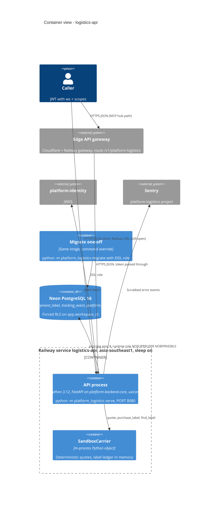

# 06 — C4 Container

Sources: ops record: api-gateway-edge (2026-11-03); `bookchaowalit-backend/platform-api-gateway@51c4711` `routes.json`; `bookchaowalit/platform-mcp-remote-worker@7d127c2` `wrangler.toml` `CELLS` + `src/worker.ts` `PLATFORM_CELLS`, `Dockerfile`, `.railway/railway.ts`, `src/platform_logistics/__main__.py`, `src/platform_logistics/app.py`, `src/platform_logistics/carriers.py`, `src/platform_logistics/migrations.py`, `docs/runtime.md`, `pyproject.toml`, ops record: book-platforms-status (2026-11-03) (region, sleep, Neon project, Sentry project)

## Open questions

- Neon project `platform-logistics` มี compute/branch และ region ใด — ops record ระบุเพียงรูปแบบชื่อ `platform-<svc>`
- `migrate` ถูกรันอย่างไรบน Railway (one-off service? local?) — ไม่มีบันทึก
