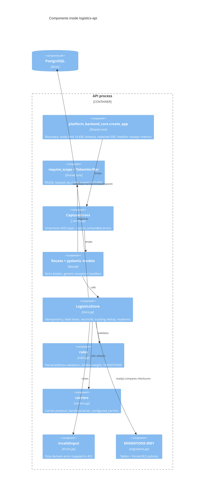

# 07 — C4 Component (API process)

Sources: `src/platform_logistics/app.py`, `src/platform_logistics/store.py`, `src/platform_logistics/rules.py`, `src/platform_logistics/carriers.py`, `src/platform_logistics/errors.py`, `src/platform_logistics/migrations.py`, `src/platform_logistics/_sentry.py`, `docs/runtime.md` (shared core limits)

หมายเหตุ: ลำดับ middleware มาจากคอมเมนต์ใน `app.py` ("Last in the list = innermost: inside the core boundary that turns errors into a 500").
