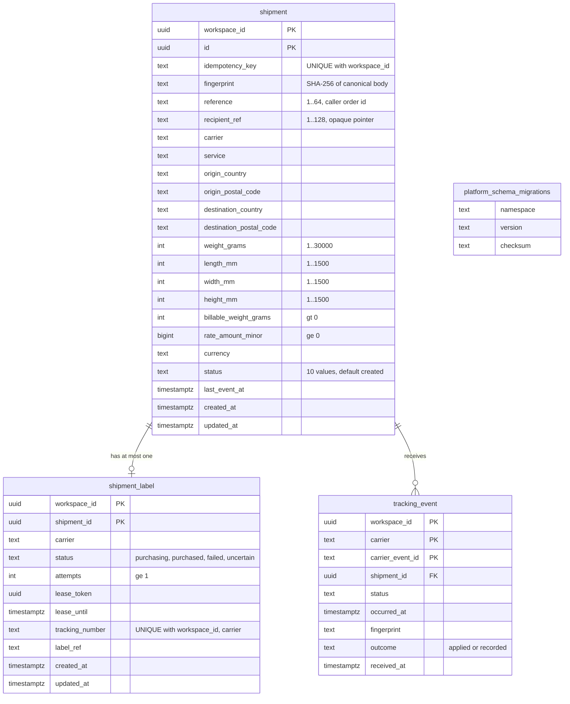

# 09 — ERD

จาก migration `0001` ใน `src/platform_logistics/migrations.py` (namespace `logistics`). ตาราง `platform_schema_migrations` เป็นของ shared core `MigrationRunner` (คอลัมน์ที่เห็นในโค้ดนี้: `namespace`, `version`, `checksum`).

Sources: `src/platform_logistics/migrations.py`, `src/platform_logistics/store.py` (`ready`, `fingerprint`)

## Constraints และ RLS

- FK แบบ composite: `shipment_label(workspace_id, shipment_id)` และ `tracking_event(workspace_id, shipment_id)` → `shipment(workspace_id, id)`.
- CHECK: `(status='purchased') = (tracking_number IS NOT NULL AND label_ref IS NOT NULL)`.
- Index: `tracking_event(workspace_id, shipment_id, occurred_at)`.
- ทั้ง 3 ตาราง: `ENABLE` + `FORCE ROW LEVEL SECURITY`, policy `workspace` `USING`/`WITH CHECK` `workspace_id = nullif(current_setting('app.workspace_id', true), '')::uuid`.
- Runtime role: NOSUPERUSER NOBYPASSRLS; grants ตาม ADR-0003; ไม่มี DELETE/TRUNCATE.
- ข้อมูลส่วนบุคคล: ไม่มีชื่อ ที่อยู่ถนน เบอร์โทร อีเมล; `recipient_ref` regex `[A-Za-z0-9_.:-]{1,128}` ปฏิเสธช่องว่างจึงกันชื่อ/ที่อยู่ (`store.RECIPIENT_REF`).

Sources: `src/platform_logistics/migrations.py`, `src/platform_logistics/store.py`, `docs/runtime.md` (Runtime grants, Data held)

Central: [ERD-DIAGRAMS.md](https://github.com/bookchaowalit/architecture-docs/blob/main/docs/architecture/ERD-DIAGRAMS.md) ไม่มี logistics.

## Open questions

- ชนิดคอลัมน์ของ `platform_schema_migrations` อยู่ใน shared core; ด้านบนแสดงเป็น `text` ตามที่ใช้ใน query เท่านั้น
