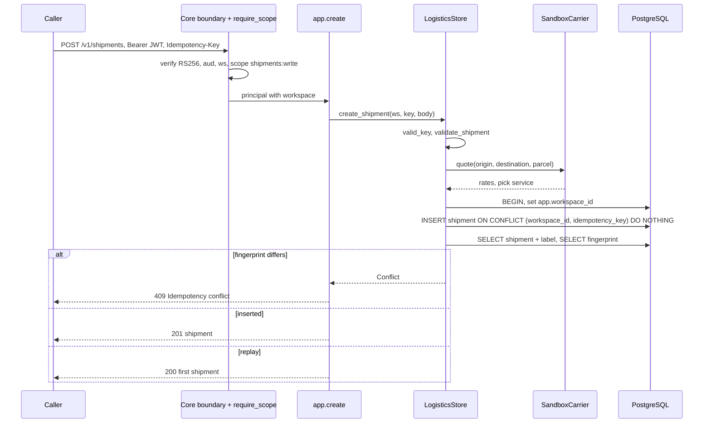
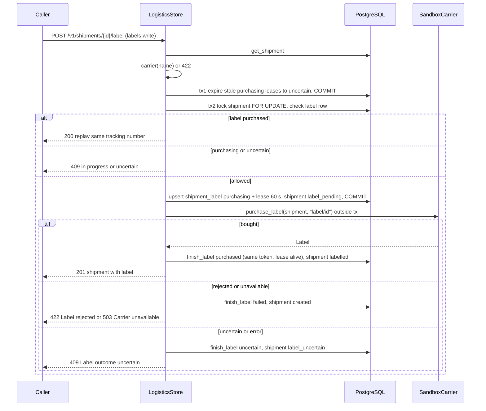
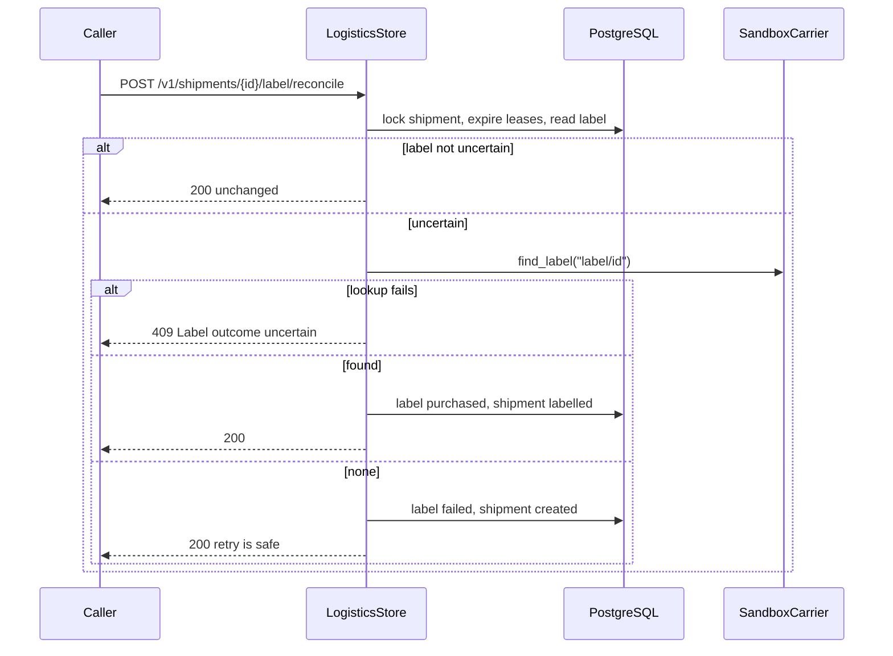
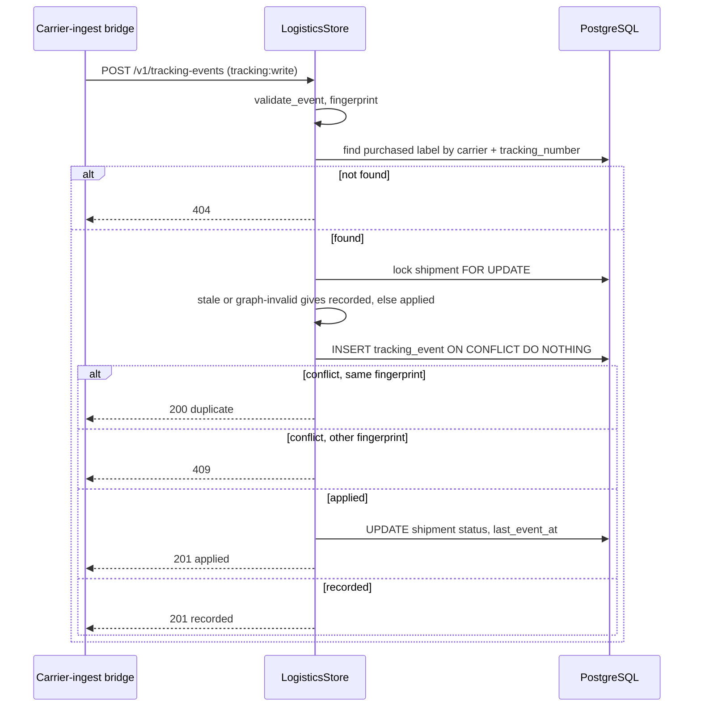

# 10 — Sequences

## 1. Create shipment (idempotent)

## 2. Buy label (lease, carrier call, finish)

## 3. Reconcile uncertain label

## 4. Tracking event (dedup)

Sources: `src/platform_logistics/app.py`, `src/platform_logistics/store.py`, `src/platform_logistics/carriers.py`, `docs/runtime.md`, `runtime_tests/test_labels.py`, `runtime_tests/test_tracking.py`

หมายเหตุ: "set app.workspace_id" ทำใน `Database.transaction(workspace)` ของ shared core (อนุมานจาก policy ใน `migrations.py` และ docstring ของ `store.py`).
