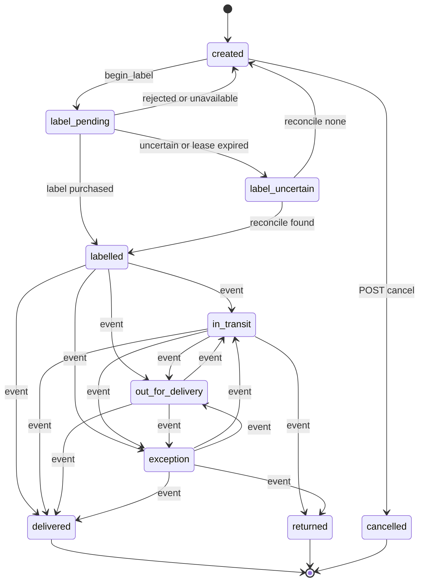
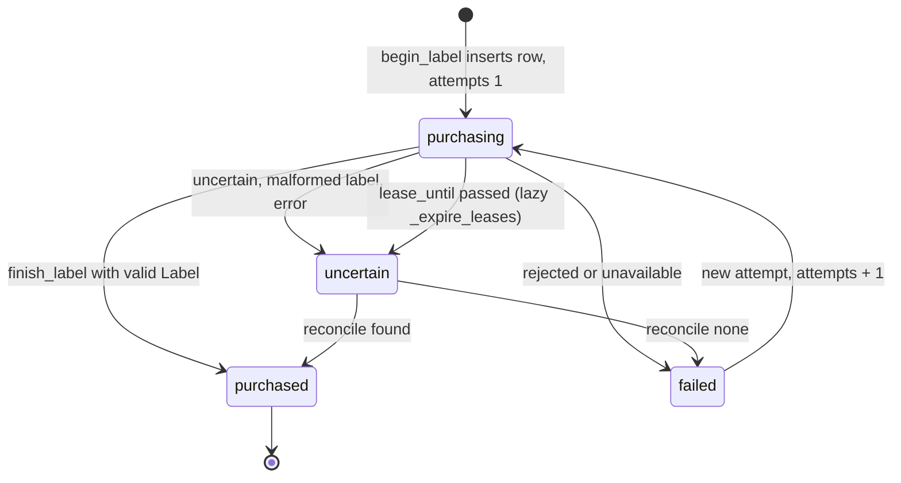
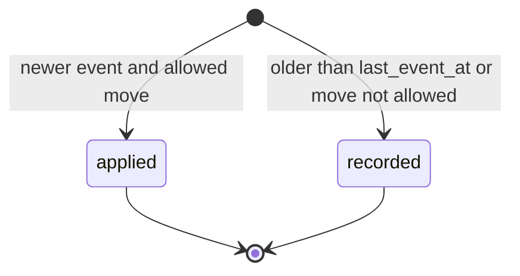

# 11 — State machines

## shipment.status

ตรงกับ `rules.TRANSITIONS` ทุกเส้น. `delivered`, `returned`, `cancelled` เป็น terminal.

Sources: `src/platform_logistics/rules.py` (`TRANSITIONS`), `src/platform_logistics/store.py`, `src/platform_logistics/migrations.py` (CHECK on status), `runtime_tests/test_rates_and_transitions.py` (`test_transitions_follow_the_fulfillment_graph`)

## shipment_label.status

Sources: `src/platform_logistics/store.py` (`begin_label`, `finish_label`, `_expire_leases`, `reconcile_label`), `src/platform_logistics/migrations.py`, `runtime_tests/test_labels.py`

## tracking_event.outcome

แถวเกิดครั้งเดียวและไม่เปลี่ยน (`applied` หรือ `recorded`); `duplicate` เป็นผลตอบกลับ HTTP ไม่ได้เก็บ.

Sources: `src/platform_logistics/store.py` (`record_tracking_event`), `src/platform_logistics/migrations.py` (CHECK on outcome)
