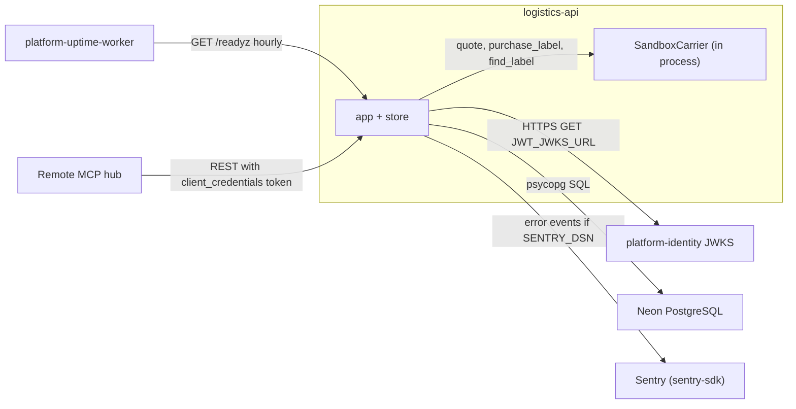

# 12 — API and integrations

รายการ route ครบทุกตัวจาก `app.py` (ทั้งหมดอยู่หลัง `require_scope`; token ไม่มีหรือผิด = 401, scope ไม่พอ = 403 จาก shared core). Body จำกัด 16 KiB (`max_body_bytes=16384`), model ทั้งหมด `extra='forbid'`.

| Method | Path | Scope | Idempotency | Success | Errors |
|---|---|---|---|---|---|
| POST | `/v1/rates` | `rates:read` | read-only, deterministic | 200 `{rates}` | 422 |
| POST | `/v1/shipments` | `shipments:write` | `Idempotency-Key` required (`[A-Za-z0-9_.:/-]{1,128}`), per workspace, fingerprint = SHA-256 canonical body | 201 new / 200 replay | 409 changed body, 422 |
| GET | `/v1/shipments?limit=1..100&after=uuid` | `shipments:read` | read | 200 list by id | 422 |
| GET | `/v1/shipments/{id}` | `shipments:read` | read | 200 | 404 |
| POST | `/v1/shipments/{id}/cancel` | `shipments:write` | ซ้ำได้ผลเดิมไม่ได้: ครั้งที่สองเป็น 409 (cancelled เป็น terminal) | 200 | 404, 409 |
| POST | `/v1/shipments/{id}/label` | `labels:write` | carrier key `label/<id>`; replay ของ label ที่ซื้อแล้วได้ 200 tracking number เดิม | 201 bought / 200 replay | 404, 409 in progress / uncertain / transition, 422 rejected or unknown carrier, 503 carrier unavailable |
| POST | `/v1/shipments/{id}/label/reconcile` | `labels:write` | ปลอดภัยที่จะเรียกซ้ำ; label ที่ไม่ uncertain คืนค่าเดิม | 200 | 404, 409, 422 |
| POST | `/v1/tracking-events` | `tracking:write` | dedupe ด้วย `(workspace_id, carrier, carrier_event_id)` | 201 applied/recorded, 200 duplicate | 404, 409, 422 |
| GET | `/v1/shipments/{id}/events` | `shipments:read` | read, ≤500 แถว | 200 | 404 |
| GET | `/healthz`, `/readyz`, `/metrics` | none (shared core) | — | 200 / 503 | — |

Sources: `src/platform_logistics/app.py`, `src/platform_logistics/store.py`, `docs/runtime.md` (API), `runtime_tests/test_http.py`, `runtime_tests/test_error_mapping.py`

`contract.json` ยังไม่ declare interface ใด (`interfaces: []`, `docs/CONTRACT-SURFACE.md`). ไม่มี OpenAPI ที่ commit ไว้. Shared core ที่ pin (`21d5f44`) สร้าง `FastAPI(title=service_name, lifespan=..., debug=False)` โดยไม่ปิด `docs_url`/`openapi_url` จึงคาดว่า `/docs` และ `/openapi.json` เปิดตาม default ของ FastAPI (ยังไม่ได้ยืนยันบน production). `/metrics` ไม่มี auth: counter `platform_http_requests_total{route,status}` และ `platform_http_request_duration_seconds_sum` (route template เท่านั้น).

Sources (core): `platform-backend-core` `git show 21d5f44:src/platform_backend_core/http.py` (local checkout, read-only)

## External integrations

Sources: `src/platform_logistics/__main__.py`, `src/platform_logistics/carriers.py`, `src/platform_logistics/_sentry.py`, `pyproject.toml` (deps `platform-backend-core`, `uvicorn`, `sentry-sdk`), `PRODUCT.md`, ops record: book-platforms-status (2026-11-03)

- ไม่มี webhook ขาเข้าจาก carrier ที่ลงลายเซ็น และไม่มี HTTP client ออกไปหา carrier (`docs/runtime.md` Deliberate omissions).
- ไม่มี event/queue publish.

## Open questions

- มีใคร scrape `/metrics` หรือไม่ (ops record: observability เป็น library, "a scraper would keep sleeping services awake") และควรปิดจากสาธารณะหรือไม่
- ยืนยันบน production ว่า `/docs` และ `/openapi.json` ตอบ 200 หรือไม่ และต้องการให้เปิดหรือไม่
