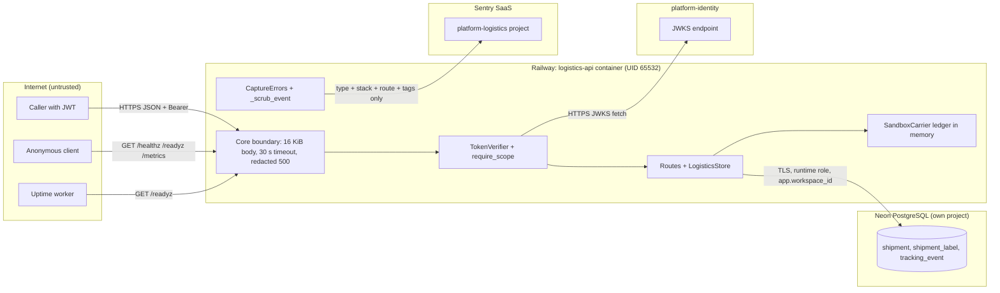

# 13 — Threat model (DFD + STRIDE)

## DFD with trust boundaries

Sources: `src/platform_logistics/app.py`, `src/platform_logistics/__main__.py`, `src/platform_logistics/_sentry.py`, `src/platform_logistics/migrations.py`, `src/platform_logistics/carriers.py`, `Dockerfile` (`USER 65532:65532`), `docs/runtime.md`, ops record: book-platforms-status (2026-11-03)

ไม่มี provider ภายนอกอื่น (Stripe, Resend, R2) ใน service นี้. ทาง edge gateway ไม่มีหลักฐานว่า route logistics ผ่าน gateway (ดู Open questions).

## STRIDE per element

| Element | Threat (STRIDE) | Mitigation found in code | Gap |
|---|---|---|---|
| Caller → API | S: ปลอม token | RS256 verify iss/aud, required claims `sub ws iat exp jti iss aud` (core), audience `logistics-api` | — |
| Caller → API | E: ข้าม tenant | workspace จาก `ws` เท่านั้น; forced RLS + `WITH CHECK`; runtime role NOBYPASSRLS; test `test_workspaces_are_isolated_and_rls_rejects_foreign_rows` | — |
| Caller → API | E: scope ไม่พอ | `require_scope` ทุก route; 403 | `labels:write` ทั้งซื้อและ reconcile (ไม่มี scope แยก) |
| Caller → API | T: replay/ซ้ำ | `Idempotency-Key` + fingerprint; label key `label/<id>`; tracking dedup PK | ไม่ใช้ `jti` เป็น replay cache (ไม่พบในโค้ด service) |
| Caller → API | D: flood | body ≤16 KiB, `limit_concurrency=100`, pool 8, SQL timeout 10 s, HTTP 30 s (`docs/runtime.md`) | ไม่มี rate limit ต่อ workspace, ไม่มี shipment cap |
| Anonymous → `/metrics` | I: เปิดเผยข้อมูลการใช้งาน | เฉพาะ route template + status count (core) | ไม่มี auth บน `/metrics`; `/docs` `/openapi.json` น่าจะเปิด (12-api-integration) |
| Carrier-ingest bridge | S: ปลอม carrier event | ต้องถือ `tracking:write`; tracking number ต้องเป็น label ของ workspace เดียวกัน | ไม่มี webhook signature check (`docs/runtime.md`) |
| Carrier-ingest bridge | T: event ย้อนสถานะ | `last_event_at` stale → `recorded`; graph check `rules.TRANSITIONS`; occurred_at ≥2000 และ ≤ now+1 วัน | — |
| LogisticsStore → Carrier | T/R: ซื้อ label ซ้ำ | lease 60 s, uncertain quarantine, reconcile ผ่าน `find_label` | ledger ของ sandbox อยู่ใน memory: หลัง Railway sleep/restart `find_label` คืน None → label ถูกตั้งเป็น `failed` (ปลอดภัยกับ sandbox เพราะ tracking number มาจาก hash ของ key เดียวกัน แต่เป็นความเสี่ยงถ้าคง logic นี้กับ carrier จริงที่ไม่ authoritative) |
| API → Neon | I: รั่ว connection string | startup error เป็นบรรทัด generic; Sentry `include_local_variables=False`; ค่าใน Railway + Infisical `/platform-logistics` | — |
| API → Neon | T: schema drift | `/readyz` ตรวจ checksum migration และ RLS; API ไม่ migrate เอง | — |
| Data store | I: PII | ไม่เก็บชื่อ/ที่อยู่/โทร/อีเมล; `recipient_ref` regex; log มีแค่ route/status/correlation id; test `caplog` | postal code + country เก็บเป็น plain text (ข้อมูลระดับพื้นที่) |
| Data store | R: audit | `created_at`/`updated_at`, `attempts`, `tracking_event.received_at` | ไม่มี actor (`sub`) บันทึกในแถว; ไม่ส่ง audit ไป security-api |
| API → Sentry | I: free text รั่ว | `_scrub_event` ทิ้ง message/value/breadcrumbs/request/user/extra; tracing ปิด; 51-case test | — |
| API → identity JWKS | D/S: identity ล่มหรือ redirect | core `_JWKS`: HTTPS only, ไม่ follow redirect, timeout 5 s, cache พร้อม refresh interval แบบมีขอบเขต | อนุมาน: ถ้า JWKS ล่มนานกว่า cache, request ใหม่จะ 401 (ยังไม่ได้ทดสอบ) |
| Container | E: privilege | non-root UID 65532; image ไม่มี git/build tools; actions pin SHA | — |
| Supply chain | T: dependency confusion | core จาก Git commit pin; `uv.lock`; shared `security.yml` | — |

Sources: ตามตารางด้านบน, `runtime_tests/test_sentry.py`, `runtime_tests/test_http.py`, `runtime_tests/test_tracking.py`, `runtime_tests/test_review_fixes.py`, `tests/test_build_hygiene.py`, `pyproject.toml`, `.github/workflows/check.yml`, core `21d5f44:src/platform_backend_core/http.py` และ `auth.py` (required claims)

Central: [ATTACK-PATH-DIAGRAMS.md](https://github.com/bookchaowalit/architecture-docs/blob/main/docs/architecture/ATTACK-PATH-DIAGRAMS.md) ไม่มี logistics.

## Open questions

- logistics-api อยู่หลัง `gateway.bookchaowalit.com` (origin lock `X-Gateway-Edge`) หรือเปิดตรงที่ `*.up.railway.app` เท่านั้น?
- จะเพิ่ม signature check ก่อนมี carrier webhook จริงหรือไม่?
- ต้องการ audit event (actor) ไป security-api สำหรับการซื้อ label หรือไม่?
