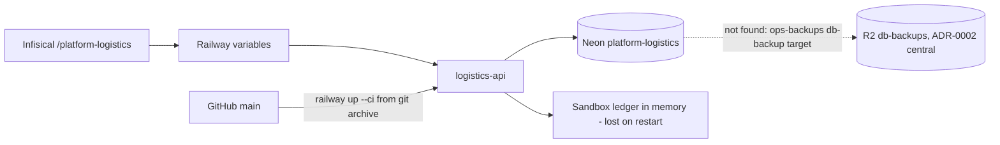

# 14 — Backup and DR

## ข้อมูลที่มีและอยู่ที่ไหน

| Data | Where | Owner of copy | Backup reality |
|---|---|---|---|
| `shipment`, `shipment_label`, `tracking_event`, `platform_schema_migrations` | Neon project `platform-logistics` (ชื่อตามรูปแบบ `platform-<svc>`) | service นี้ (`data_owner: platform-logistics`) | Neon managed (PITR ตาม plan free ไม่ได้ระบุในเอกสาร repo); logical backup ไป R2 **ไม่พบหลักฐาน** |
| Sandbox label ledger (`SandboxCarrier._labels`) | process memory ของ container | — | ไม่มี; หายทุกครั้งที่ sleep/restart/redeploy |
| Secrets (`DATABASE_URL`, `JWT_*`, `SENTRY_DSN`, `LOGISTICS_CARRIERS`) | Railway variables + Infisical `/platform-logistics` | owner | Infisical เป็นสำเนาหลัก |
| Code + image recipe | GitHub `bookchaowalit-backend/platform-logistics` | owner | git; image สร้างใหม่ได้จาก `Dockerfile` |

Sources: `src/platform_logistics/migrations.py`, `src/platform_logistics/carriers.py`, `src/platform_logistics/__main__.py`, `contract.json`, `PRODUCT.md`, `docs/runtime.md`, ops record: book-platforms-status (2026-11-03)

Sources: เหมือนตารางด้านบน; central [ADR-0002](https://github.com/bookchaowalit/architecture-docs/blob/main/docs/architecture/decisions/ADR-0002-production-baseline-monitoring-backups.md) (nightly age-encrypted `pg_dump` ของ Neon ทุกตัวผ่าน `ops-backups/db-backup`, retention 14/56/365 วัน, monthly restore drill, RTO ≤ 4 h ต่อ database)

เส้นประ = ยังไม่มีหลักฐานว่า logistics อยู่ใน backup target. Clone `platform-db-backup` ในเครื่อง (`27a0a68`) ไม่มีคำว่า logistics; target อาจตั้งเป็น variable `BACKUP_URL_*` บน Railway ซึ่งไม่ได้ตรวจ.

## Restore (จาก repo)

- "Never downgrade applied SQL. Restore only into a new isolated database." (`docs/runtime.md`)
- Restore แล้วต้องสร้าง runtime role NOSUPERUSER NOBYPASSRLS พร้อม grant ตาม ADR-0003 จึงจะได้ `/readyz` 200 (`store.ready`).
- Rollback ของ service: "Rollback stops this optional runtime; no consumer uses it yet." (`docs/runtime.md`)

## RTO / RPO

- RTO: not defined ใน repo (central ADR-0002 ตั้งเป้า ≤ 4 h ต่อ database แต่ใช้กับ target ที่อยู่ใน backup เท่านั้น)
- RPO: not defined

## Open questions

- Neon `platform-logistics` อยู่ใน `ops-backups/db-backup` (มี `db_backup` role) และ restore drill หรือยัง?
- หลัง restore ข้อมูล label ที่ `uncertain` จะ reconcile อย่างไรเมื่อ sandbox ledger หายไปแล้ว (`find_label` คืน None → `failed`)?
