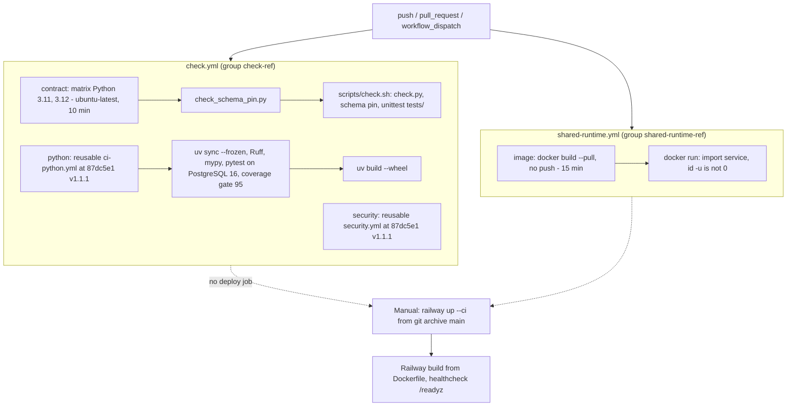

# 15 — CI/CD pipeline

สอง workflow; ทั้งคู่ trigger `push` (ทุก branch), `pull_request`, `workflow_dispatch`; `permissions: contents: read`; concurrency ต่อ ref แบบ cancel-in-progress. ไม่มี job deploy.

Sources: `.github/workflows/check.yml`, `.github/workflows/shared-runtime.yml`, `scripts/check.sh`, `railway.toml`, `PRODUCT.md` (CI, "Deploys are Railway CLI uploads"), ops record: book-platforms-status (2026-11-03) (deploy recipe)

- Jobs ทั้ง 3 ใน `check.yml` ไม่มี `needs:` ต่อกัน จึงรันขนานกัน.
- Runner: GitHub-hosted (`ubuntu-latest`) เพราะ repo public (`PRODUCT.md`).
- `tests/test_build_hygiene.py` บังคับว่าทุก `uses:` ต้อง pin 40-hex SHA และ CI ต้อง build image.

## Open questions

- ขั้นตอนภายใน `ci-python.yml` / `security.yml` อยู่ใน repo `bookchaowalit/platform-ci-workflows` (ไม่ได้อ่าน); รายละเอียด security scan (เช่น gitleaks/pip-audit) ไม่ได้ยืนยัน
- มี branch protection / required checks บน `main` หรือไม่ — ไม่มีข้อมูลใน repo
