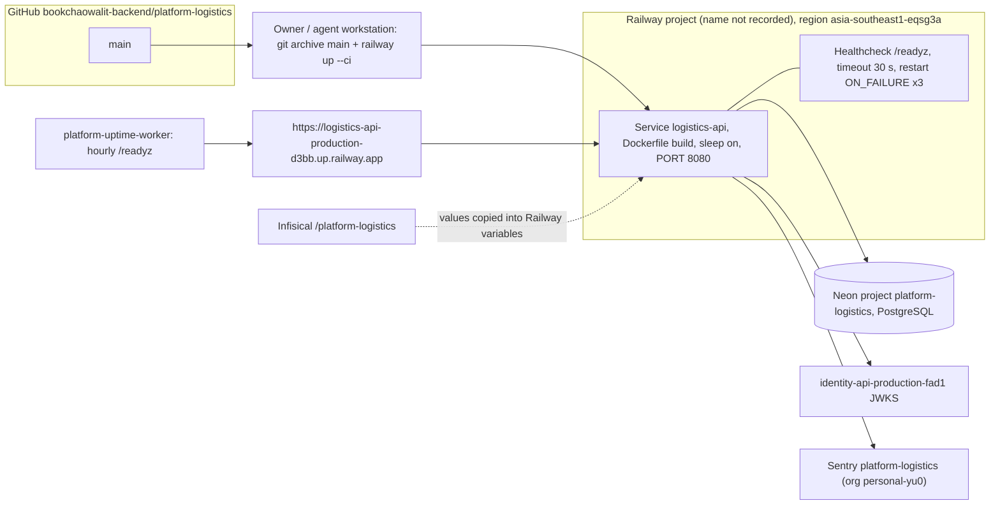

# 16 — Deployment

Sources: `.railway/railway.ts`, `Dockerfile`, `src/platform_logistics/__main__.py`, `PRODUCT.md` (Operating Context), ops record: book-platforms-status (2026-11-03) (live list, region, sleep, Neon/Infisical/Sentry naming, JWT issuer, deploy recipe, monitoring); `bookchaowalit/platform-uptime-worker` `src/targets.ts` @ `fe04d27` (`logistics-api` → `/readyz`)

## Environment variables (names only)

| Variable | Used by | Source |
|---|---|---|
| `DATABASE_URL` | serve (runtime role), migrate (DDL role) | `__main__.py` |
| `JWT_ISSUER`, `JWT_AUDIENCE`, `JWT_JWKS_URL` or `JWT_PUBLIC_KEY` | serve | `__main__.py` |
| `LOGISTICS_CARRIERS` (`sandbox`) | serve, readiness | `carriers.py` |
| `PORT` (default 8080) | serve | `__main__.py`, `Dockerfile` |
| `SENTRY_DSN`, `SENTRY_ENVIRONMENT`, `SENTRY_RELEASE` | Sentry | `_sentry.py` |
| `RAILWAY_GIT_COMMIT_SHA`, `RAILWAY_SERVICE_NAME` | Sentry release/tag | `_sentry.py` |

## Health

- `/healthz`: process alive (`{"status":"ok"}`).
- `/readyz`: `database.ready()` ของ core และ check `logistics_schema` (grants, migration checksums, forced RLS) + `carriers` (มี carrier configured) → 200 หรือ 503.
- Railway sleep: request แรกหลัง idle ต้องปลุก container และ Neon (resume ~6–9 s ตาม ops record).

Sources: `src/platform_logistics/app.py`, `src/platform_logistics/store.py`, core `21d5f44:src/platform_backend_core/http.py`

## Open questions

- ชื่อ Railway project จริง (ops record ไม่ระบุชื่อ project ของ logistics) และ project id
- deploy ล่าสุดเป็น commit ใด — ops record ระบุ 501601f (2026-11-03); `96f23af` (CI/PRODUCT.md เท่านั้น) deploy แล้วหรือไม่ไม่ทราบ
- `RAILWAY_GIT_COMMIT_SHA` ว่างเมื่อ deploy ด้วย CLI upload หรือไม่ (ถ้าว่าง Sentry release = unset)
