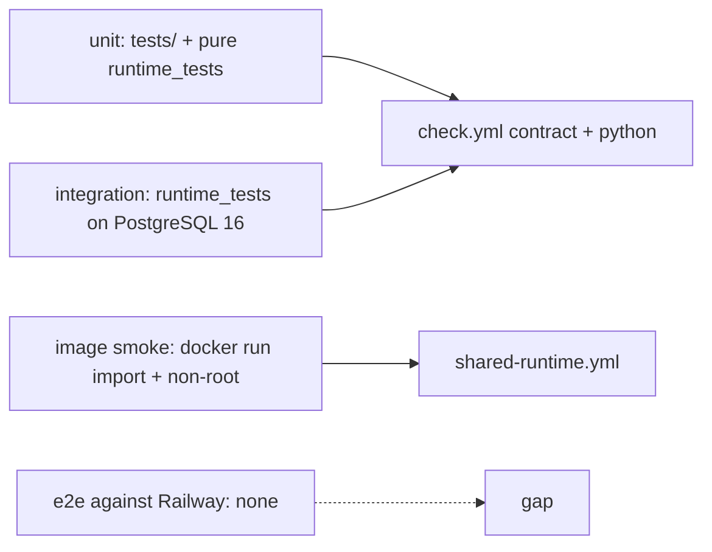

# 17 — Test coverage matrix

นิยามระดับ (จากโค้ด test จริง):
- **unit**: ไม่ต้องใช้ DB (`tests/` แบบ unittest และ case ใน `runtime_tests/` ที่ไม่ใช้ fixture `database`/`temp_db`).
- **integration**: ใช้ PostgreSQL จริงผ่าน `PLATFORM_TEST_DSN` + role NOSUPERUSER NOBYPASSRLS + JWT RS256 จริง; HTTP ผ่าน `fastapi.testclient` (ใน process).
- **e2e**: เรียก service ที่ deploy แล้ว — ไม่มีใน repo.

| Feature | unit | integration (DB) | integration (HTTP in-process) | e2e |
|---|---|---|---|---|
| Rates / billable weight / tariff | `test_rates_and_transitions.py` | — | `test_http.py` (`test_rates_need_scope_and_are_deterministic`) | gap |
| Status graph | `test_rates_and_transitions.py` | `test_shipments.py` (`test_cancel_only_from_created`) | `test_http.py` (`test_cancel_and_unknown_ids`) | gap |
| Shipment idempotency | — | `test_shipments.py` | `test_http.py` (`test_shipment_lifecycle_over_http`) | gap |
| Workspace isolation / RLS | — | `test_shipments.py`, `test_pool_reuse.py` | — | gap |
| Label purchase / replay / quarantine | `test_labels.py` (`test_carrier_error_outcomes_are_normalized`) | `test_labels.py`, `test_review_fixes.py` | `test_http.py` (uncertain + definite failures) | gap |
| Tracking dedup | — | `test_tracking.py`, `test_review_fixes.py` | `test_http.py` | gap |
| Error mapping (422 only InvalidInput) | `test_error_mapping.py` | — | `test_error_mapping.py` (`client`) | gap |
| Readiness / privileges | — | `test_http.py` (missing schema/carrier, each privilege) | `test_http.py` | uptime worker only (นอก repo) |
| Lifecycle (serve/migrate, generic startup error) | `test_lifecycle.py` | — | — | gap |
| Sentry scrubbing | `test_sentry.py` | — | `test_sentry.py` (`test_a_server_500_reaches_sentry_scrubbed`) | gap |
| Contract + schema pin + registry drift | `tests/test_contract_check.py`, `tests/test_drift_checks.py` | — | — | n/a |
| Build hygiene (Dockerfile, SHA pins) | `tests/test_build_hygiene.py` | — | — | CI `image` job builds + runs image |
| No PII in logs | — | — | `test_http.py` (`caplog` ใน lifecycle test) | gap |

Sources: `tests/*.py`, `runtime_tests/*.py`, `runtime_tests/conftest.py`, `pyproject.toml` (`testpaths`), `.github/workflows/check.yml` (coverage gate 95, measured 95.24% on 2026-11-03), `.github/workflows/shared-runtime.yml`, `docs/runtime.md` (verification records)

## Gaps

- ไม่มี e2e/smoke หลัง deploy (`docs/runtime.md` Staging plan step 3 อธิบาย smoke test แต่ไม่มี script ใน repo).
- ไม่มี test ของการ restart/sleep ที่ล้าง sandbox ledger.
- ไม่มี load/concurrency test ที่ระดับ `limit_concurrency=100`.
