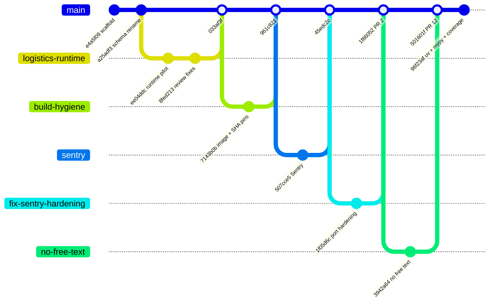
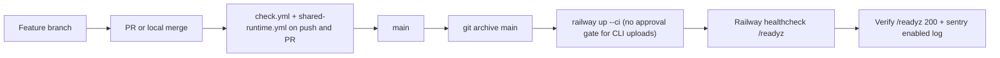

# 18 — Git and release workflow

จาก `git log` (90 วัน): งานเข้าทาง branch → PR หรือ merge commit ลง `main` (PR #2–#13 merged 2026-11-02/03; ก่อนหน้านั้น merge commit จาก branch เช่น `logistics-runtime`, `build-hygiene`, `invalid-input`, `sentry`). ไม่มี tag หรือ GitHub release. Deploy แยกจาก git: owner/agent รัน `railway up --ci` จาก `git archive main`.

Sources: `git log --since=90.days origin/main`, `gh pr list -R bookchaowalit-backend/platform-logistics --state all`, `.github/workflows/check.yml`, `.github/workflows/shared-runtime.yml`, `railway.toml`, ops record: book-platforms-status (2026-11-03) (deploy recipe, "CLI uploads need no approval", "/readyz 200, `sentry: enabled` logged")

ชื่อ branch ใน gitGraph ย่อมาจาก merge message (เช่น "Merge Sentry error reporting (sentry)") หรือ `gh pr list`: `fix-sentry-hardening` = `fix/sentry-hardening-port` (PR #2), `no-free-text` = `fix/sentry-no-free-text` (PR #12). PR #3–#11 (`fix/sentry-*`) และ #13 (`ci/uv-lock-mypy-product`) ไม่ได้วาดทีละเส้น.

## Open questions

- PR #1 (open, "port the hardened scrubber") ถูกแทนที่แล้ว — ปิดได้หรือไม่ (ops record: "superseded PRs from branch `sentry-hardened-scrubber`")
- จะมี tag/release ต่อ deploy หรือไม่ เพื่อให้วัด DORA ได้
