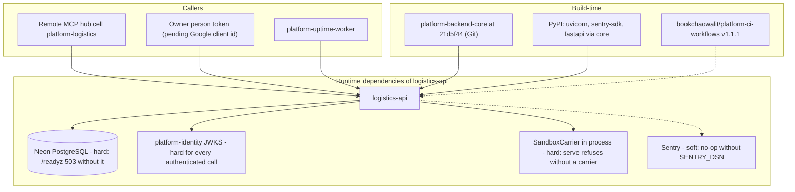

# 19 — Service dependency map

Sources: `pyproject.toml`, `Dockerfile`, `.github/workflows/check.yml`, `src/platform_logistics/__main__.py`, `src/platform_logistics/app.py`, `src/platform_logistics/carriers.py`, `src/platform_logistics/_sentry.py`, `contract.json` (`depends_on: identity, observability`), ops record: book-platforms-status (2026-11-03)

- `contract.json` ระบุ `observability` เป็น dependency แต่ไม่มีโค้ดเรียก observability library; สิ่งที่มีคือ `/metrics` ของ core และ Sentry. ops record: observability เป็น library ไม่ใช่ service.
- ไม่มี service-to-service call ขาออก (ไม่มี `ServiceTokenSource`; core ยัง pin `21d5f44`).
- ไม่มี CDN.

## Open questions

- consumer ในอนาคต (commerce?) จะเรียกผ่าน REST + identity service client ตามแนวทาง "Service↔service stays REST" ใน ops record หรือไม่
