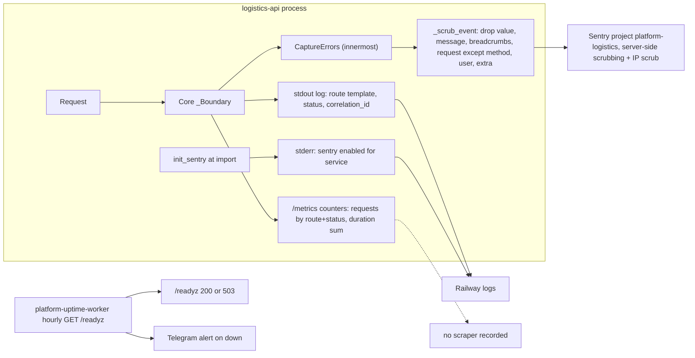

# 20 — Observability

Sources: `src/platform_logistics/_sentry.py`, `src/platform_logistics/__init__.py`, `src/platform_logistics/app.py`, `src/platform_logistics/__main__.py` (`access_log=False`), core `21d5f44:src/platform_backend_core/http.py` (log line, metrics), `docs/runtime.md` (log content test), `PRODUCT.md` (Measures, uptime worker), ops record: book-platforms-status (2026-11-03) (Monitoring), `bookchaowalit/platform-uptime-worker` `src/targets.ts` @ `fe04d27`; central [ADR-0002](https://github.com/bookchaowalit/architecture-docs/blob/main/docs/architecture/decisions/ADR-0002-production-baseline-monitoring-backups.md) (Telegram alerts, down after 2 failures)

## สิ่งที่ถูกเฝ้าดู

| Signal | Watched by | Threshold / alert |
|---|---|---|
| `/readyz` | uptime worker (กลุ่ม `own`, sleeping set) | ตาม ADR-0002: down หลัง 2 ครั้งติด → Telegram |
| Unhandled exceptions (500) | Sentry `platform-logistics` | alert rule ไม่ได้บันทึก |
| Logs | Railway | ไม่มี alert |
| `/metrics` | ไม่มี | — |
| Heartbeat | ไม่มี (service ไม่มี cron) | — |
| PostHog | ไม่มี (backend) | — |

## Open questions

- Sentry alert rule ของ `platform-logistics` คืออะไร ส่งไปที่ใด?
- ops record บอก "hourly" แต่ ADR-0002 บอก cron `*/5`; sleeping set ถูก probe ถี่แค่ไหนจริง?
