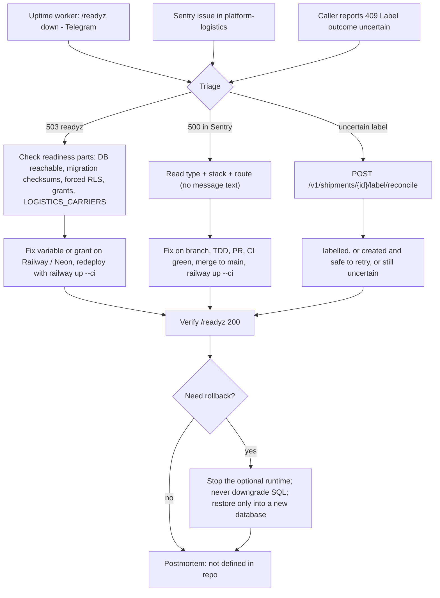

# 21 — Incident response

ไม่มี RUNBOOK ใน repo. Flow ด้านล่างประกอบจากช่องทาง alert ที่มีจริงและขั้นตอน rollback/restore ที่ `docs/runtime.md` ระบุ.

Sources: `docs/runtime.md` (readiness, Rollback, Label purchase reconcile), `src/platform_logistics/store.py` (`ready`, `reconcile_label`), `src/platform_logistics/_sentry.py`, `.railway/railway.ts`, `PRODUCT.md`, ops record: book-platforms-status (2026-11-03) (uptime worker, Sentry, deploy recipe); central [ADR-0002](https://github.com/bookchaowalit/architecture-docs/blob/main/docs/architecture/decisions/ADR-0002-production-baseline-monitoring-backups.md) (Telegram)

## Open questions

- ไม่มี postmortem template / severity ใน repo; ใช้ของกลางที่ใด?
- Sentry alert ไปช่องทางใด (Telegram? email?)
- ใครเป็น on-call เมื่อมี consumer จริง
