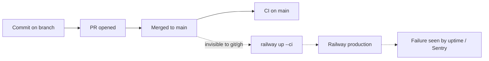

# 22 — DORA metrics

ช่วงวัด: 90 วันถึง 2026-11-03. ข้อจำกัดหลัก: deploy ทำด้วย `railway up --ci` จาก workstation (ไม่มี deploy job, ไม่มี tag, ไม่มี GitHub Deployment) ดังนั้น git/gh **มองไม่เห็นการ deploy**. git/gh เห็นได้เฉพาะ commit, PR และผล CI. ค่าที่เกี่ยวกับ deploy ด้านล่างจึงมาจาก ops record หรือทำเครื่องหมายว่าคำนวณไม่ได้.



Sources: `.github/workflows/check.yml`, `.github/workflows/shared-runtime.yml`, `.railway/railway.ts`, ops record: book-platforms-status (2026-11-03)

| Metric | How measured for this repo | Current value (90 d) | Command |
|---|---|---|---|
| Deployment frequency | ควรนับ Railway deployments ของ `logistics-api`; git/gh ไม่มีข้อมูล | **คำนวณไม่ได้จาก git/gh.** ops record บันทึก deploy อย่างน้อย 2 ครั้ง: first live 2026-10-29 และ 501601f (2026-11-03). Proxy: 24 first-parent commits บน `main`, 18 merges | `git log --since=90.days --first-parent --oneline origin/main \| wc -l`; `git log --since=90.days --merges --oneline origin/main \| wc -l` |
| Lead time for changes | commit author time → merge เข้า main (proxy เพราะไม่รู้เวลา deploy) | median **6 นาที**, max 518 นาที (26 commits ใน merge 18 ตัว); PR open→merge median **5.9 นาที**, max 19.7 นาที (12 merged PRs) | ดูสคริปต์ด้านล่าง |
| Change fail rate | ควรเป็น deploy ที่ทำให้เกิด failure ใน prod; ไม่มีข้อมูล deploy | **คำนวณไม่ได้.** Proxy CI: workflow `Check` บน `main` fail 2 จาก 22 runs (9%) — `aba4d92` และ `a25adf3` วันที่ 2026-10-13 | `gh run list -R bookchaowalit-backend/platform-logistics --branch main --limit 100 --json workflowName,conclusion` |
| Failed deployment recovery time | เวลาจาก deploy ที่พังถึงกู้ได้; ไม่มีข้อมูล deploy/incident | **คำนวณไม่ได้.** Proxy CI: `main` แดงตั้งแต่ 2026-10-13 03:38Z (`a25adf3`) ถึง run เขียวแรกบน `main` หลัง `3699fbc` (2026-10-29) ≈ 16 วัน (ไม่มี consumer จึงไม่กระทบใคร) | `gh run list ... --branch main --json createdAt,conclusion,headSha` |
| Deployment rework rate | deploy ที่เป็นการแก้ deploy ก่อนหน้า (ไม่ได้วางแผน) | **คำนวณไม่ได้.** Proxy: 10 จาก 12 merged PRs (#3–#12) เป็นการแก้ Sentry scrubber ซ้ำต่อจาก #2 ภายใน ~12 ชั่วโมง; ไม่ทราบว่าแต่ละตัว deploy หรือไม่ | `gh pr list -R bookchaowalit-backend/platform-logistics --state merged --json number,title,mergedAt` |

สคริปต์ lead time (commit → merge บน main):

```bash
git log --since=90.days --merges --first-parent --format='%H %ct' origin/main |
while read h t; do
  for c in $(git rev-list $h^1..$h^2); do
    echo $(( (t - $(git log -1 --format=%at $c)) / 60 ))
  done
done | sort -n   # median 6, max 518 (minutes), 26 commits
```

PR open → merge: `gh pr list -R bookchaowalit-backend/platform-logistics --state merged --limit 50 --json createdAt,mergedAt` แล้วหา median ของ `mergedAt - createdAt`.

Sources: คำสั่งด้านบนรันวันที่ 2026-11-03 บน worktree ที่ `origin/main` = `96f23af`; ops record: book-platforms-status (2026-11-03)

## จะวัดได้จริงต้องมีอะไร

- บันทึก deploy (Railway deployments API ของ service, หรือ tag/GitHub Deployment ต่อ `railway up`) — จะได้ deployment frequency และ lead time จริง
- ผูก incident (uptime down, Sentry issue ใหม่) กับ deploy — จะได้ change fail rate และ recovery time

## Open questions

- ยอมให้ดึง Railway deployment list (CLI/GraphQL) มาเป็นแหล่ง DORA หรือไม่?
